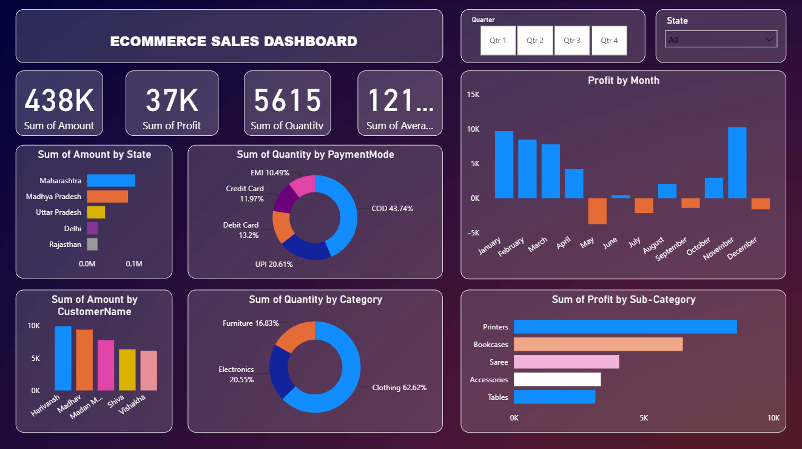

# E-Commerce Sales Dashboard | Power BI

## 📌 Project Overview
This project presents an interactive E-Commerce Sales Dashboard built using Power BI to analyze sales, profit, quantity, customer performance, payment modes, product categories, and regional trends.

## 📊 Key Performance Indicators (KPIs)
- Total Sales: 438K
- Total Profit: 37K
- Total Quantity: 5,615
- Average Value: 121 (as displayed in the dashboard)

## 📈 Dashboard Features
- Sales analysis by state
- Profit trends by month
- Quantity analysis by payment mode
- Customer-wise sales analysis
- Category-wise quantity distribution
- Sub-category-wise profit analysis
- Interactive Quarter and State filters

## 🛠️ Tools Used
- Power BI
- Data Visualization
- Business Data Analysis

## 💡 Business Insights
- Maharashtra contributes the highest sales among the displayed states.
- COD accounts for the largest share of quantity by payment mode.
- Clothing represents the largest category share of quantity.
- Printers contribute the highest profit among the displayed sub-categories.
- Monthly profit analysis highlights both profitable and loss-making months.

## 📷 Dashboard Preview

